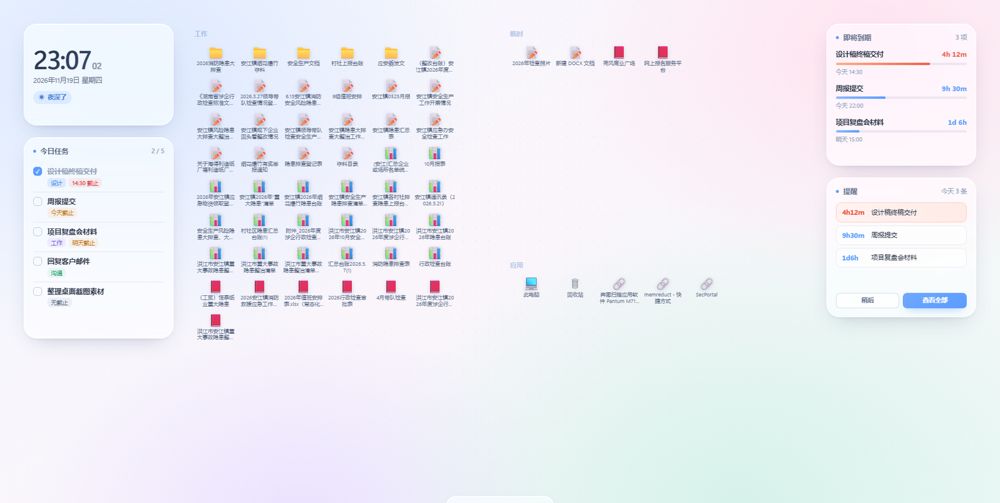

# 潮汐 · Tide Desk

一个贴着 Windows 桌面的任务看板。它把自己铺在壁纸之上、普通窗口之下：不占任务栏、不进 Alt+Tab、Win+D 也收不走，鼠标只在你真正想点的组件上生效，其余地方直接穿透到桌面。



## 它做什么

- **桌面常驻** — 开机自启，铺满工作区但压在壁纸层，不会挡到别的窗口
- **今日任务** — 新建、勾选、截止时间；临期自动弹悬浮提醒条（可「完成」或「稍后 15 分钟」）
- **即将到期** — 按剩余时间排的倒计时列表
- **提醒** — 任务提醒 + 读取 Windows 通知中心里的系统 toast，可单条删除或全部清空
- **桌面图标整理** — 把图标按「工作 / 临时 / 应用」分区重排，分区可拖拽缩放；改动直接写回真实桌面
- **快照** — 存一份当前图标布局，随时还原
- **外观** — 主色、不透明度、毛玻璃、圆角，四套预设
- **自动备份** — 每次保存前留一份，保留最近 12 份

## 环境要求

- Windows 10 / 11（图标读写、通知中心、开机自启都用了 Win32 / WinRT，其他平台不适用）
- [Node.js](https://nodejs.org/) 20.19+ 或 22.12+（Vite 8 的要求）
- [Rust](https://rustup.rs/) 1.90+（Tauri 2 的 MSRV）
- WebView2 Runtime（Win11 自带；Win10 一般也有，没有就装）
- Visual Studio C++ 生成工具（MSVC 工具链，Tauri 在 Windows 上必需）

## 开始

```bash
npm install
npm run tauri dev      # 开发：前端热更新 + Rust 侧热重载
npm run tauri build    # 打包：产出 NSIS 安装包
```

前端单独预览（不启动 Tauri，界面会喂假数据）：

```bash
npm run dev            # http://localhost:5273
```

> 开发端口固定为 `5273`，被占用会直接失败而不是换端口 —— 因为 `tauri.conf.json` 里的 `devUrl` 写死了。

安装包在 `src-tauri/target/release/bundle/nsis/`。

## 数据放在哪

全部在 `%APPDATA%\tide-desk\`：

| 文件 | 内容 |
| --- | --- |
| `state.json` | 主题、组件位置、分区、任务、图标归属 |
| `desk-snapshot.json` | 最近一次保存的桌面图标坐标快照 |
| `backups/state-YYYYMMDD-HHMMSS.json` | 自动备份（最多 12 份） |

写 `state.json` 走「临时文件 → fsync → rename」的原子写，断电最多丢一次改动，不会写出半截 JSON 把旧数据一起毁掉。

## 实现上值得一提的几处

**贴在壁纸上、Win+D 收不走。** 启动后把窗口 z-order 插到 `Progman`（桌面窗口）的上面一格，于是它在壁纸之上、所有普通窗口之下。`WM_SYSCOMMAND / SC_MINIMIZE` 直接吞掉，所以 Win+D / Win+M 也不会把它最小化。

**真·鼠标穿透。** 前端把各个组件和 dock 的矩形推给后端，`hit_set` 用 `CreateRectRgn` + `CombineRgn(RGN_OR)` 拼成一个区域 `SetWindowRgn` 上去，窗口只在这些矩形内存在。只靠 `WM_NCHITTEST` 返回 `HTTRANSPARENT` 不够——那个只在同进程内有效，跨进程（双击桌面图标、别的程序）照样被吞。

**读写真实桌面图标。** 找到 `SHELLDLL_DefView` 下的 `SysListView32`，用 `LVM_GETITEMCOUNT` / `LVM_GETITEMTEXTW` / `LVM_GETITEMPOSITION` 跨进程取名字和坐标（`OpenProcess` + `VirtualAllocEx` 拿一块远程缓冲放 `LVITEMW` 和文本），摆位用 `LVM_SETITEMPOSITION` 把坐标打包进 `lParam`，不需要远程指针。壁纸被 `WorkerW` 接管时也能找到。

**整理模式。** 把 Explorer 画的真图标 `SW_HIDE` 掉，换成前端画的副本，拖完再写回坐标、恢复显示。同名图标可能有两份（用户桌面 + 公共桌面），匹配时把索引「用掉」，避免两个叠在同一个坐标。

**不抢焦点。** 点组件时拦 `WM_MOUSEACTIVATE` 返回 `MA_NOACTIVATE`；只有需要打字的浮层（新建任务）才临时撤掉 `WS_EX_NOACTIVATE` 并主动要一次焦点。

**系统通知。** 走 WinRT 的 `UserNotificationListener`，首次调用会弹系统授权。注意 `ClearNotifications()` 在部分 Windows 11 版本上会抛 `Element not found (0x80070490)`，所以清空改成逐条 `RemoveNotification`。

**单实例。** `Global\tide-desk-single-instance` 命名互斥体；两个实例会各画一层组件，看起来像重影，所以第二个直接退出。

## 目录

```
index.html              页面结构（组件、整理工具条、dock、浮层）
src/main.ts             前端全部逻辑
src/style.css           样式与主题变量
src/types.ts            共享类型
src-tauri/src/lib.rs    命令注册、窗口层、WndProc 钩子、自启、提醒窗
src-tauri/src/desk.rs   桌面图标的读 / 写 / 隐藏
src-tauri/src/win.rs    手写 Win32 声明（不依赖 windows crate 的版本命名）
src-tauri/src/notify.rs Windows 通知中心（WinRT）
src-tauri/src/store.rs  原子写、备份、快照
```

## 已知限制

- 仅 Windows；`notify.rs` 和开机自启都是 `cfg(windows)`
- 界面只有中文
- 多显示器只认主屏
- 需要读桌面图标，个别安全软件会拦 `OpenProcess` 到 Explorer，此时会提示「权限不足」
- 项目还在 0.1.0，`state.json` 结构可能随版本变化（备份目录是兜底）

## 许可

[MIT](LICENSE) © Air-XII
